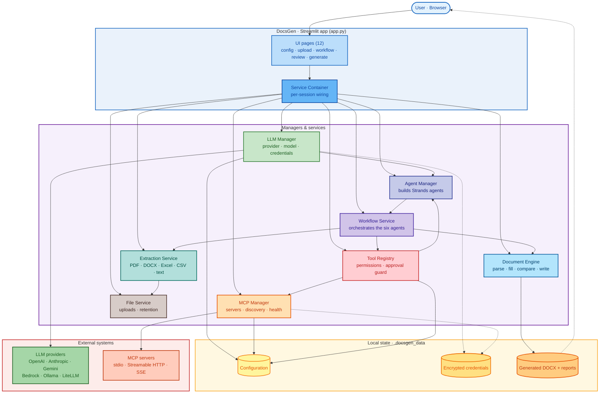

# 📄 DocsGen-AI — AI document automation

[](https://github.com/gvatsal60/docsgen-ai/actions/workflows/test.yml)


DocsGen fills **your own Word (.docx) template** with information drawn from uploaded source documents.
It runs six cooperating [Strands Agents](https://strandsagents.com), can call external tools via the
**Model Context Protocol (MCP)**, and keeps the template's formatting intact. Nothing is written into the
final document until a person has reviewed and approved it.

Everything is configured in the Streamlit UI: AI provider, API keys, model, MCP servers, tool
permissions. No code changes or restarts needed.

---

## ✨ Features

- 📝 **Template-faithful output** — fills your existing `.docx` and preserves styles, fonts, numbering, tables, headers and footers.
- 📚 **Many source formats** — PDF, DOCX, TXT, MD, CSV, XLSX/XLS.
- 🤖 **Six cooperating agents** — analyze → extract → research → generate → validate → review.
- 🔌 **MCP tools** — connect stdio, Streamable HTTP or SSE servers and pick exactly which tools each agent may use.
- 🖱️ **No-code setup** — provider, credentials, model, MCP servers and permissions are all set in the UI.
- 🛡️ **Encrypted credentials** — session-only by default, Fernet-encrypted when persisted.
- ✅ **Human in the loop** — approve, edit or reject every proposed value and section before anything is written.
- 🧪 **Testable without an LLM** — 112 tests run against a scripted model that implements the real Strands interface.

---

## 🚀 Quick start

```bash
git clone https://github.com/gvatsal60/docsgen-ai.git && cd docsgen-ai
python3 -m venv .venv                  # Python 3.12+
source .venv/bin/activate              # Windows: venv\Scripts\activate
pip install -r requirements.txt
python scripts/make_samples.py         # optional: creates sample_data/ to try the workflow
streamlit run app.py
```

Open <http://localhost:8501>, then:

1. **AI Provider Configuration**: pick a provider, enter credentials, choose a model, then click **Test Connection** and **Apply**.
2. **MCP Tool Configuration** (optional): add servers and connect them. Then enable tools and authorize them per agent in **Tool Registry**.
3. **Document Template Upload**: upload a `.docx` template. Placeholders such as `{{company_name}}` are detected automatically.
4. **Source Documents**: upload PDF, DOCX, TXT, MD, CSV, XLSX/XLS files.
5. **AI Instructions**: choose a task, write instructions, and approve any consequential tools for this run.
6. **Agent Workflow**: run the full pipeline or individual steps.
7. **Document Review**: approve, edit, or reject every proposed value and section.
8. **Document Generation**: write the DOCX and download it. Past outputs are in **History and Downloads**.

To try it with the bundled samples, use `sample_data/sample_template.docx` as the template. Use the other
files in `sample_data/` as sources.

---

## 🗺️ Architecture

DocsGen is a single Streamlit app. A per-session **Service Container** wires three independent managers
(LLM, MCP, Agent) together with the workflow, extraction, file and document services. The diagram below
shows how a request flows from the UI through those services to the model providers, MCP servers and local
state.



The three managers are independent. The **LLM Manager** owns "which model". The **MCP Manager** owns
"which external tools exist and are enabled". The **Agent Manager** combines the two at run time and
only gives each agent the tools it is authorized to use. A change in one (for example, switching
provider) applies to the next agent run without touching the others.

### Important files and directories

- `app.py` — Streamlit entry point and navigation.
- `config.py` — application settings and logging/redaction.
- `agents/` — the six cooperating Strands agents.
- `services/` — LLM/MCP/agent managers, workflow orchestration, extraction, and security.
- `document_engine/` — template parsing, placeholder handling, and formatting-preserving writing.
- `tools/` — built-in document and validation tools.
- `ui/` — Streamlit pages/components (presentation only).
- `models/`, `storage/` — shared data models and local persistence.
- `mcp_servers/demo_server.py` — bundled demo MCP server.
- `sample_data/` and `scripts/make_samples.py` — sample inputs for trying the workflow.
- `tests/` — unit, UI, and integration tests.

---

## 🤖 Agent workflow

| Agent | Role |
| --- | --- |
| Document Analyzer | Reads the template: sections, placeholders, tables, which parts need content |
| Information Extractor | Pulls facts from source documents with source citations |
| Research Agent | Optional; only runs if enabled on the Instructions page, and only with authorized tools |
| Document Generator | Drafts placeholder values and section text from extracted facts only |
| Document Validator | Checks drafts against sources and flags unsupported claims |
| Quality Reviewer | Final quality score, issues, and recommendations |

Each agent returns a Pydantic-validated structured output. The writer then applies only **approved** items.
It replaces runs in place and copies paragraph/run properties (styles, fonts, numbering, tables, headers
and footers), so the template's look is kept.

---

## 🧠 AI providers

| Provider | Auth in the UI | Notes |
| --- | --- | --- |
| OpenAI | API key, optional base URL / organization | Base URL works for any OpenAI-compatible endpoint |
| Anthropic | API key | |
| Google Gemini | API key | |
| Amazon Bedrock | AWS default credential chain / profile, access keys, or Bedrock API key | Region selectable |
| Ollama | Host URL | Local models; "Discover models" lists installed ones |
| LiteLLM | Provider-specific key + model string | Gateway to many other providers |
| Mistral, Writer, Llama API | API key | Install the extra first, e.g. `pip install "strands-agents[mistral]"` |
| llama.cpp | Server URL | |

The **Test Connection**, **Save**, **Apply** and **Clear Credentials** buttons are on the AI Provider
Configuration page. Keys are session-only by default. Turn on "Remember (encrypted)" to persist them.

---

## 🔌 MCP servers

Supported transports: **stdio**, **Streamable HTTP**, **SSE**. Supported auth: none, bearer token, API-key
header, custom headers, and OAuth client credentials (Streamable HTTP only).

Try the bundled demo server:

- **stdio**: transport `stdio`, command `python`, argument `mcp_servers/demo_server.py`
  (start Streamlit from the repository root with the venv active).
- **Streamable HTTP**: run `python mcp_servers/demo_server.py --http --port 8765`, then add URL
  `http://127.0.0.1:8765/mcp`. For bearer auth, start it with `DEMO_MCP_TOKEN=secret` and set the same token in DocsGen.
- **SSE**: `python mcp_servers/demo_server.py --sse --port 8765`.

The demo tools are `lookup_company`, `word_count`, `current_date`, and `delete_record`. `delete_record` is deliberately destructive and shows how approvals work.

You can also import and export server definitions as JSON, including the common `{"mcpServers": {...}}` format.

---

## 🛡️ Security model

- **Credentials** are kept in session memory by default. When persisted, they are encrypted with Fernet. The key comes from
  `DOCSGEN_MASTER_KEY`, or is auto-generated in `<data dir>/master.key` with mode 0600.
  The configuration store refuses to save secret-like keys in plain text.
- **Logging** runs through a redaction filter that masks keys, tokens, and auth headers. Secrets are never
  shown back in the UI; you only see "Set" or "Not set".
- **MCP is untrusted by default:**
  - stdio commands must be on an allowlist, and shells are refused.
  - Plain HTTP is allowed only for localhost unless you change the setting.
  - Tool descriptions and results are truncated.
  - Tool output is wrapped and marked as untrusted data in prompts.
  - No MCP tool is authorized for any agent until you allow it.
  - Destructive/consequential tools start disabled and need approval for each run.
  - Every call is enforced by a Strands `BeforeToolCallEvent` hook and recorded in the execution log.
- **Prompt injection**: agent system prompts tell agents to treat document and tool content as data, never as
  instructions. The generator may only use extracted, cited facts, and the validator checks this.
- **Human in the loop**: nothing reaches the output DOCX without approval on the Review page.

---

## 📁 Data locations

All state is kept in `DOCSGEN_DATA_DIR` (default `./.docsgen_data`, created with mode 0700):
configuration, encrypted credentials, master key, uploads (removed after the configured retention time), and
generated documents in `generated/<run_id>/`. Delete the directory to reset the app.

Other settings can be overridden with `DOCSGEN_<SETTING>` environment variables (see `.env.example`) or in
**Application Settings**.

---

## 🧪 Testing

```bash
pytest -q
```

The suite (112 tests) uses a scripted model that implements the real Strands `Model` interface, so the real
agents, hooks, structured-output and tool-calling paths all run without an LLM. MCP tests start the real
demo server over stdio and HTTP. UI tests drive every page with Streamlit `AppTest`.

Live tests against a real provider are skipped unless configured:

```bash
DOCSGEN_LIVE_PROVIDER=openai DOCSGEN_LIVE_MODEL=gpt-4o-mini OPENAI_API_KEY=... pytest tests/integration -m live
```

---

## ⚠️ Known limitations

- OAuth for MCP supports only the client-credentials flow, and only on Streamable HTTP. Interactive browser OAuth is not implemented.
- Scanned (image-only) PDFs are not OCR'd. Only the text layer is extracted.
- MCP connection health relies on a private Strands attribute (`_is_session_active`). It may need a small update in a future Strands release.
- Complex layouts are preserved by editing the template in place. Content that has to be *generated* into new
  table rows or new sections uses the formatting of the nearest existing paragraph or row.
- The live provider path was built against the provider SDKs. In this environment it was tested only with the scripted model.
